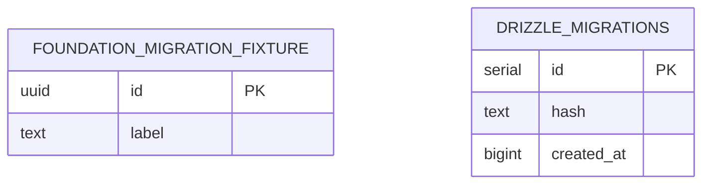
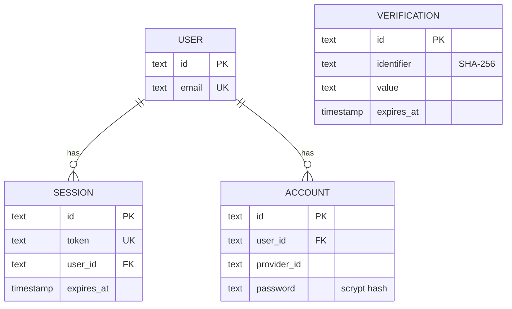

# Database: реализованная схема и следующий этап

Источник application schema — `packages/db/src/schema`; SQL и история
генерации — `packages/db/drizzle`. Источник текущих данных не следует путать
с таблицами, перечисленными как будущие в Master Plan.

## Application DB: реализовано

`0000_smiling_reavers.sql` создаёт только `public.foundation_migration_fixture`:

| Поле | SQL | Ограничения |
|---|---|---|
| `id` | uuid | PRIMARY KEY, NOT NULL, DEFAULT gen_random_uuid() |
| `label` | text | NOT NULL |

Это техническая fixture для проверки schema/migrator, не пользователь,
цель или событие. Записей с персональными данными эта схема не определяет.
Официальный Drizzle node-postgres migrator ведёт отдельный
`drizzle.__drizzle_migrations` (id/hash/created_at). Между fixture и journal
нет прикладного FK.

Диаграмма показывает только существующие технические application объекты.
Настраиваемое имя migrations schema используется тестами для изоляции.
PgBoss objects ниже управляются самим pg-boss и не генерируются Drizzle Kit.

## Auth (LFS-201)

`0001_better_auth.sql` добавляет core-таблицы Better Auth 1.7.18
(`packages/db/src/schema/auth.ts`). Имена и типы повторяют официальный
Drizzle-генератор Better Auth; решение — [ADR-005](../adr/005-auth.md).

| Таблица | Ключевые поля | Ограничения / индексы |
|---|---|---|
| `user` | id text, name, email, email_verified, image, created_at, updated_at; `timezone`, `locale` (LFS-202) | PK id; UNIQUE email (Better Auth хранит lowercase); CHECK длины timezone 1–64 и locale 2–35 |
| `session` | id, token, user_id, expires_at, ip_address, user_agent, timestamps | UNIQUE token; FK user_id → user ON DELETE CASCADE; `session_userId_idx` |
| `account` | id, account_id, provider_id, user_id, password, OAuth-поля, timestamps | FK user_id → user CASCADE; `account_userId_idx`; password — только scrypt-хэш (provider `credential`) |
| `verification` | id, identifier, value, expires_at, timestamps | `verification_identifier_idx`; identifier — SHA-256 от `reset-password:<token>`, value — user id |

Timestamps — `timestamp` без зоны, как в генераторе Better Auth; значения
пишет Better Auth из JS в UTC. FK-цели в SQL намеренно без `public.`: они
разрешаются через search_path (public в рабочих БД, изолированная schema в
тестах). Upgrade существующей Stage 1 базы только добавляет таблицы: fixture,
journal и pg-boss не меняются (проверено тестом и на main DB 2026-11-14:
public 1 → 5 таблиц, journal 1 → 2, pgboss 13 → 13).
`@lifeos/db` экспортирует client/schema; migrator — отдельный entry
`@lifeos/db/migrations`, чтобы Next.js bundle не включал SQL и migrator.

## User preferences (LFS-202)

`0002_user_preferences.sql` добавляет к `user` две колонки, которые Better Auth
не пишет и не читает ([ADR-006](../adr/006-actor-ownership.md)):

| Поле | SQL | Ограничения | Значение |
|---|---|---|---|
| `timezone` | text | NOT NULL DEFAULT `'UTC'`; CHECK `char_length` 1–64 | IANA-имя, валидирует `@lifeos/contracts` |
| `locale` | text | NOT NULL DEFAULT `'ru'`; CHECK `char_length` 2–35 | канонический BCP 47 |

Миграция только расширяет схему: константные DEFAULT заполняют существующие
строки без переписывания таблицы, данные user/session/account сохраняются
(тест upgrade базы LFS-201). Откат приложения не требует отката схемы; откат
схемы — новой forward-миграцией. Даты по-прежнему в UTC, timezone влияет только
на отображение и будущую статистику по дням. Ownership: preferences меняются
только по `user.id = actor.userId`; будущие персональные таблицы получают
`user_id` с FK на `user` ON DELETE CASCADE и фильтр `ownedBy`.
`@lifeos/db` экспортирует repository `createUserPreferencesRepository` и SQL-фильтр
`ownedBy`; порт repository и `Actor` объявлены в `@lifeos/domain`.

## Queue schema

Worker/producer `boss.start()` создаёт/обновляет технические объекты
pg-boss 12.38.1 в `WORKER_QUEUE_SCHEMA` (default `pgboss`). Там находятся
queue metadata, jobs и состояния, версия schema, технические schedule/
subscription/warning/statistics objects согласно manifest закреплённого пакета.
Ключевые для текущего demo объекты — `queue`, `job`, partitioned job storage
и enum `job_state`. Полный набор и имена per-queue partitions принадлежат
версии pg-boss; application migrations их не копируют.

Partitioned manifest `pg-boss/dist/schema.json` версии 12.38.1 перечисляет
`bam`, `instance`, `job`, `job_common`, `job_dependency`, `queue`, `queue_stats`,
`schedule`, `subscription`, `version`, `warning`; per-queue partitions создаются
динамически. Это библиотечная technical schema, не новые доменные модели LifeOS.

Внутренний scheduler выключен, supervision включён у worker. Наличие
технической schedule/subscription таблицы не означает готовые бизнес-расписания
или уведомления. `demo.ping` хранит synthetic payload и output с техническими IDs.

Application DB и очередь используют один PostgreSQL и совместимый драйвер
pg, но обычные pools независимы. Для атомарного enqueue нужен именно adapter,
привязанный к Drizzle tx; [ADR atomicity](../adr/002-queue-atomicity.md).

## Локальные main/test instances

| Сервис | Адрес по умолчанию | DB / роль | Volume |
|---|---|---|---|
| `postgres` | 127.0.0.1:15432 | lifeos / lifeos | postgres_data |
| `postgres-test` | 127.0.0.1:15433 | lifeos_test / lifeos_test | postgres_test_data |

Compose project `lifeos-foundation` задаёт фактические prefixed volume names.
Оба используют PostgreSQL 18.6-bookworm с immutable digest из ADR-001,
healthcheck и loopback ports. Для PG18 volume монтируется в `/var/lib/postgresql`,
PGDATA — `/var/lib/postgresql/18/docker`. Credentials генерируются в ignored
root `.env`; существующий файл не перезаписывается. Это разные roles/passwords/
instances, а не два имени одной application DB.

`pnpm db:migrate` работает с DATABASE_URL. `pnpm db:migrate:test` принимает
только TEST_DATABASE_URL и проверяет dedicated test target до pool.
`readTestDatabaseUrl` требует lifeos_test или lifeos_test_* и отклоняет
совпадение с application target, включая localhost aliases/default port.
CI имеет собственный disposable service с lifeos_test_ci.

## Test-only объекты

| Проверка | Namespace / таблицы | Срок жизни |
|---|---|---|
| Migration smoke LFS-104 | lfs104_migration_uuid: fixture и migration journal | Свежая schema каждого запуска, cleanup known tables + RESTRICT |
| Worker LFS-105 | lfs105_queue_uuid: pg-boss objects | Свежая schema suite; официальный uninstall + DROP SCHEMA RESTRICT |
| Atomicity LFS-107 | lfs107_atomic_uuid: pg-boss и foundation_test_operations | Свежая schema suite; cleanup только owned objects |
| Test migration CLI LFS-108 | public fixture, auth tables и drizzle journal в test instance | Сохраняются, повторный migrate не дублирует journal |
| Upgrade Stage 1 → LFS-201 | lfs201_upgrade_uuid: fixture, auth tables, journal | Свежая schema; cleanup known tables + RESTRICT |
| Better Auth LFS-201 | lfs201_auth_uuid: все application tables и journal | Свежая schema suite; cleanup known tables + RESTRICT |
| Upgrade LFS-201 → LFS-202 | lfs202_upgrade_uuid: auth tables с данными, затем 0002 | Свежая schema; cleanup known tables + RESTRICT |
| Preferences LFS-202 | lfs202_preferences_uuid: все application tables и journal | Свежая schema suite (support/auth-harness.ts); cleanup known tables + RESTRICT |
| Ownership LFS-202 | lfs202_ownership_uuid: application tables + test-only `ownership_fixture_note` (id uuid PK, user_id FK → user CASCADE, body) | Свежая schema suite; fixture не входит в application migrations/exports |

`foundation_test_operations` имеет id PK, idempotency_key UNIQUE, created_at,
JSON payload, queue_name, job_id UNIQUE, processed_at и effect_count. CHECK
разрешает только «не обработано / 0» или «обработано / 1». Fixture DDL находится
в `packages/db/tests/fixtures/atomicity.sql`, отсутствует в production schema,
exports/dist и application migration history. Это обычная таблица с временным
сроком жизни suite, а не session-local TEMP TABLE.

Tests никогда не должны принимать application DATABASE_URL как fallback,
делать DROP DATABASE, удалять volumes или присваивать себе существующую schema.
Миграции применяются повторяемо; уже применённые SQL/snapshots не переписываются.
Удаление старой fixture в будущем оформляется новой миграцией.

## Goals · LFS-205

`packages/db/src/schema/goals.ts`, миграция `0003_goals.sql`.
Политики точности, изменения определения и отката — [ADR-007](../adr/007-goals.md).

| Поле | Хранение / правило |
|---|---|
| `id` | UUID PK, default gen_random_uuid() |
| `user_id` | text NOT NULL FK → user.id CASCADE; определяется Actor |
| `domain_key` | text, CHECK по шести DOMAIN_KEYS |
| `title`, `description` | title 1..200; description null или 1..4000, текст нормализуется contract |
| `unit`, `unit_label` | NOK/count/minutes/percent/custom; label обязателен только для custom (1..40) |
| `baseline`, `target` | точный numeric без typmod; 0 ≤ value < 10^22, до 8 дробных знаков; DTO decimal string |
| `direction` | increase: target > baseline; decrease: target < baseline; равенство запрещено |
| `calculation_mode`, `metric_key` | только manual / null в Stage 2; computed отклоняется |
| `status` | active по умолчанию; archived сохраняет данные и запрещает правку |
| `due_at` | nullable timestamptz(3), абсолютный срок, finite, UTC DTO |
| `created_at`, `updated_at` | timestamptz(3), серверное now(), finite |

NOK: до 2 дробных знаков; count: целое; percent: 0..100; minutes/custom:
до 8. БД отклоняет избыточную значащую точность, а не округляет. Определение
цели неизменно через domain API; правятся только title/description/due_at,
архивирование — отдельная команда. Repository каждый раз использует user_id;
чужой ресурс не раскрывается. Индексы `(user_id, domain_key, status)` и
`(user_id, status, due_at, id)` не требуют выборок по другим пользователям.

Таблица не содержит current/progress: current читается из measurements
(LFS-206), расчёт progress и HTTP — LFS-207; UI целей пока не реализован.

## Activity events и command receipts · LFS-210

`0004_activity_events.sql` добавляет `activity_events` и узкую таблицу
`goal_command_receipts`; policies — [ADR-008](../adr/008-transactional-audit.md).

| Таблица | Поля / ограничения |
|---|---|
| `activity_events` | UUID id; обязательные user_id/domain_key/goal_id, event_type/source, target_type/id, schema_version=1, occurred_at/payload/created_at; optional idempotency_key |
| `goal_command_receipts` | PK (user_id,idempotency_key), SHA-256 request_hash, operation/source, goal_id/domain_key, created_at; без request/response body |

Обе таблицы имеют compound FK `(user_id,domain_key,goal_id)` → goals;
parent получает соответствующий UNIQUE. Это защищает owner/domain при любом
SQL INSERT. Event target_id измерения сохраняется после удаления
измерения; обязательный parent goal остаётся связью ownership.
В events — unique owner/key для non-null ключей, owner/domain/time и
owner/goal/time indexes. JSON ограничен по размеру/ключам, типы snapshots —
strict Zod. Личные тексты и auth data не копируются; metadata changes отмечаются
именами полей. Время реальных записей — UTC clock_timestamp после блокировок.

Идемпотентность включает no-op команды: их receipt хранится без вымышленного
события. Replay возвращает актуальный ресурс, не старый response; changed
payload/operation/target/source — CONFLICT. Квитанции сохраняются при архиве.
Существующим целям события задним числом не придумываются. Изменение цели,
event и receipt коммитятся/откатываются вместе; user/goal deletion каскадный.

## Goal measurements · LFS-206

`0005_goal_measurements.sql`, [ADR-009](../adr/009-goal-measurements.md).

| Поле | Хранение / правило |
|---|---|
| `id`, `goal_id`, `user_id` | UUID PK; обязательные parent и owner, задаваемые сервером |
| `unit` | копия неизменной единицы parent; compound FK (user_id,goal_id,unit) → goals (user_id,id,unit) CASCADE |
| `value` | numeric без typmod, exact string DTO; те же value/unit CHECK, что у goals |
| `measured_at` | timestamptz(3), finite, UTC год 1..9999, не дальше 5 минут в будущем |
| `source`, `note` | manual; note null или 1..1000 непустых символов, contract trim |
| `created_at`, `updated_at` | серверный clock_timestamp, finite |

Current/history используют measured_at DESC, created_at DESC, id DESC;
индекс с префиксом user_id/goal_id поддерживает этот порядок. History до 100.
Updated_at не меняет tie-breaker; baseline не подставляется вместо null.
Backdated insert разрешён. У archived parent все свежие write-команды
запрещены domain под parent lock; чтение сохраняется.

Receipts расширены resource_type (DEFAULT goal) и nullable target_id;
measurement target обязателен и допускаются measurement.create/update/delete.
FK на child нет: delete result восстанавливается по receipt после удаления.
Legacy goal target_id=null остаётся валидным, fingerprint прежний. Старые
goals/events/receipts не переписываются, вымышленных измерений/backfill нет.
Measurement mutation/event/receipt атомарны; note contents не аудируются.

## Stage 2: следующие модели и API

LFS-207 читает goal/count/latest/audit-time в едином READ ONLY REPEATABLE READ
snapshot, без нового DDL. `progress.updatedAt` учитывает max audit occurred_at,
включая удаление замера; `provenance.updatedAt` — правку последнего измерения.
History HTTP использует cursor/limit и возвращает count всех замеров;
старый domain history method LFS-206 остаётся bounded reader до 100.
[ADR-010](../adr/010-goals-api-progress.md).

Goals UI появится в следующей задаче. Каждая персональная
запись должна иметь user_id или проверяемую связь с владельцем; repositories
проверяют ownership на сервере. Реестр шести сфер реализован в коде (LFS-203),
не как универсальная таблица domains. Общего «процента успешности жизни» нет.
Telegram identities, conversations, AI runs и учебные модели относятся к
последующим этапам, также не реализованы.

Технический API client/migrator: [DB README](../../packages/db/README.md).
Команды запуска: [root README](../../README.md). Состояние проверок:
[Stage 1 acceptance](../tasks/STAGE-01-ACCEPTANCE.md).
