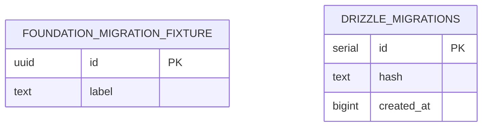

# Database: реализованная схема и следующий этап

Источник application schema — `packages/db/src/schema`; SQL и история
генерации — `packages/db/drizzle`. Источник текущих данных не следует путать
с таблицами, перечисленными как будущие в Master Plan.

## Application DB: реализовано

`0000_smiling_reavers.sql` создаёт только `public.foundation_migration_fixture`:

| Поле | SQL | Ограничения |
|---|---|---|
| `id` | uuid | PRIMARY KEY, NOT NULL, DEFAULT gen_random_uuid() |
| `label` | text | NOT NULL |

Это техническая fixture для проверки schema/migrator, не пользователь,
цель или событие. Записей с персональными данными эта схема не определяет.
Официальный Drizzle node-postgres migrator ведёт отдельный
`drizzle.__drizzle_migrations` (id/hash/created_at). Между fixture и journal
нет прикладного FK.

Диаграмма показывает только существующие технические application объекты.
Настраиваемое имя migrations schema используется тестами для изоляции.
PgBoss objects ниже управляются самим pg-boss и не генерируются Drizzle Kit.

## Queue schema

Worker/producer `boss.start()` создаёт/обновляет технические объекты
pg-boss 12.38.1 в `WORKER_QUEUE_SCHEMA` (default `pgboss`). Там находятся
queue metadata, jobs и состояния, версия schema, технические schedule/
subscription/warning/statistics objects согласно manifest закреплённого пакета.
Ключевые для текущего demo объекты — `queue`, `job`, partitioned job storage
и enum `job_state`. Полный набор и имена per-queue partitions принадлежат
версии pg-boss; application migrations их не копируют.

Partitioned manifest `pg-boss/dist/schema.json` версии 12.38.1 перечисляет
`bam`, `instance`, `job`, `job_common`, `job_dependency`, `queue`, `queue_stats`,
`schedule`, `subscription`, `version`, `warning`; per-queue partitions создаются
динамически. Это библиотечная technical schema, не новые доменные модели LifeOS.

Внутренний scheduler выключен, supervision включён у worker. Наличие
технической schedule/subscription таблицы не означает готовые бизнес-расписания
или уведомления. `demo.ping` хранит synthetic payload и output с техническими IDs.

Application DB и очередь используют один PostgreSQL и совместимый драйвер
pg, но обычные pools независимы. Для атомарного enqueue нужен именно adapter,
привязанный к Drizzle tx; [ADR atomicity](../adr/002-queue-atomicity.md).

## Локальные main/test instances

| Сервис | Адрес по умолчанию | DB / роль | Volume |
|---|---|---|---|
| `postgres` | 127.0.0.1:15432 | lifeos / lifeos | postgres_data |
| `postgres-test` | 127.0.0.1:15433 | lifeos_test / lifeos_test | postgres_test_data |

Compose project `lifeos-foundation` задаёт фактические prefixed volume names.
Оба используют PostgreSQL 18.6-bookworm с immutable digest из ADR-001,
healthcheck и loopback ports. Для PG18 volume монтируется в `/var/lib/postgresql`,
PGDATA — `/var/lib/postgresql/18/docker`. Credentials генерируются в ignored
root `.env`; существующий файл не перезаписывается. Это разные roles/passwords/
instances, а не два имени одной application DB.

`pnpm db:migrate` работает с DATABASE_URL. `pnpm db:migrate:test` принимает
только TEST_DATABASE_URL и проверяет dedicated test target до pool.
`readTestDatabaseUrl` требует lifeos_test или lifeos_test_* и отклоняет
совпадение с application target, включая localhost aliases/default port.
CI имеет собственный disposable service с lifeos_test_ci.

## Test-only объекты

| Проверка | Namespace / таблицы | Срок жизни |
|---|---|---|
| Migration smoke LFS-104 | lfs104_migration_uuid: fixture и migration journal | Свежая schema каждого запуска, cleanup known tables + RESTRICT |
| Worker LFS-105 | lfs105_queue_uuid: pg-boss objects | Свежая schema suite; официальный uninstall + DROP SCHEMA RESTRICT |
| Atomicity LFS-107 | lfs107_atomic_uuid: pg-boss и foundation_test_operations | Свежая schema suite; cleanup только owned objects |
| Test migration CLI LFS-108 | public fixture и drizzle journal в test instance | Сохраняются, повторный migrate не дублирует journal |

`foundation_test_operations` имеет id PK, idempotency_key UNIQUE, created_at,
JSON payload, queue_name, job_id UNIQUE, processed_at и effect_count. CHECK
разрешает только «не обработано / 0» или «обработано / 1». Fixture DDL находится
в `packages/db/tests/fixtures/atomicity.sql`, отсутствует в production schema,
exports/dist и application migration history. Это обычная таблица с временным
сроком жизни suite, а не session-local TEMP TABLE.

Tests никогда не должны принимать application DATABASE_URL как fallback,
делать DROP DATABASE, удалять volumes или присваивать себе существующую schema.
Миграции применяются повторяемо; уже применённые SQL/snapshots не переписываются.
Удаление старой fixture в будущем оформляется новой миграцией.

## Stage 2: только план, не создано

| Будущая модель | Задача / требование |
|---|---|
| Better Auth tables / user | LFS-201/202: auth, timezone/locale, серверный ownership; точная auth schema выбирается при интеграции |
| `goals` | LFS-205: владелец, сфера, baseline/target/unit, направление, срок и тип расчёта |
| `goal_measurements` | LFS-206: ручные измерения, source/provenance, idempotency и аудит |
| `activity_events` | LFS-210: FK на владельца, аудит изменений в общей транзакции |

Это не текущий DDL/ERD и не утверждение о готовых APIs. Каждая персональная
запись должна иметь user_id или проверяемую связь с владельцем; repositories
проверяют ownership на сервере. Реестр шести сфер планируется в коде (LFS-203),
не как универсальная таблица domains. Общего «процента успешности жизни» нет.
Telegram identities, conversations, AI runs и учебные модели относятся к
последующим этапам, также не реализованы.

Технический API client/migrator: [DB README](../../packages/db/README.md).
Команды запуска: [root README](../../README.md). Состояние проверок:
[Stage 1 acceptance](../tasks/STAGE-01-ACCEPTANCE.md).
