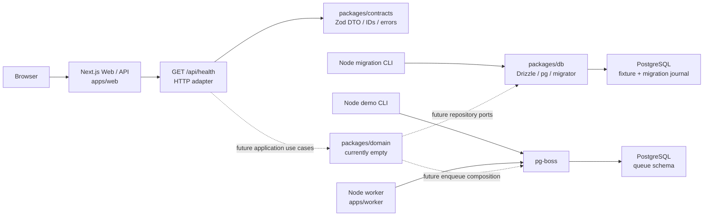

# LifeOS Foundation: система и границы

Состояние LFS-109: реализован технический Foundation. Рабочих модулей
Languages/Finance/Work/Projects/Skills/Health, аккаунтов и персонального
Dashboard пока нет. Названия шести сфер в UI — presentation-only anchor links,
а не доменный registry. Источник продуктового плана —
[Master Plan v0.4](../reference/LifeOS_Master_Plan_v0.4.md); его формулировки здесь не меняются.

## Процессы и поток данных

Сплошные связи исполняются сейчас. Пунктир показывает направление будущей
композиции и не обозначает готовые use cases или HTTP producer. Обе части
PostgreSQL находятся в одной application DB; локальная test DB — отдельный
instance. HTTP health не выполняет SQL и не проверяет доступность очереди.

Web, worker и producer CLI — отдельные Node процессы. `pnpm dev` запускает
только Web и build его dependencies; worker запускается отдельно через
`pnpm worker:dev` / `pnpm worker:start`. Worker не стартует из route handler,
React render или instrumentation. Доменная логика не должна зависеть от
жизненного цикла HTTP-запроса.

## Пакеты и разрешённые зависимости

| Путь | Текущая роль | Граница |
|---|---|---|
| `apps/web` | React UI, Next routes/layouts, HTTP helper/error mapper, startup composition | Будущие transport/auth adapters; бизнес-правила должны оставаться в пакетах |
| `apps/worker` | PgBoss lifecycle, demo handler, producer CLI, безопасные технические логи | Не импортирует Web; будущие application/domain functions подключаются через пакеты |
| `packages/contracts` | Zod schemas, inferred DTO/types, health envelope, IDs и demo payload | Нет зависимости от apps, React, Next или env; можно использовать в browser |
| `packages/config` | Strict tsconfig, ESLint config; отдельный Node export `./env` | Tooling exports не читают env; runtime parser вызывается явно |
| `packages/db` | Drizzle schema, pg client factory, миграции и защитные DB helpers | Репозитории бизнес-моделей ещё не реализованы; module import не открывает соединение |
| `packages/domain` | Пустой framework-independent модуль, реальные lint/typecheck | Нет Next/React/apps imports, SQL и обхода будущих repositories |

Web и worker объявляют зависимости на DB/config/contracts в manifests.
В текущем production Web нет использования DB client. Production worker
обращается к очереди через pg-boss, а не через application Drizzle client;
общая Drizzle transaction продемонстрирована только integration fixture.
Пакеты не зависят от приложений; приложения не экспортируются как библиотеки.

Application layer — правило размещения будущих use cases внутри packages,
не отдельный уже существующий `packages/application` или backend service.
Языковой учитель не определяет архитектуру всей платформы. Новые Redis,
NestJS/Prisma, микросервисы или другой стек требуют отдельного согласованного ADR.

## Web, маршруты и состояния

| URL | Файл | Текущее поведение |
|---|---|---|
| `/` | `apps/web/app/(web)/page.tsx` | Каркас, шесть будущих сфер, без персональных чисел/процентов |
| `/telegram` | `apps/web/app/(telegram)/telegram/page.tsx` | Компактная заглушка Mini App, без Telegram SDK/linking |
| `/api/health` | `apps/web/app/api/health/route.ts` | Dynamic JSON envelope, текущий ISO timestamp, no-store, request/correlation ID |
| Неизвестный URL | `apps/web/app/not-found.tsx` | HTML 404 |

Единственный root layout — `app/layout.tsx`; `(web)` и `(telegram)` выбирают
внутренние layouts, но не добавляют URL segments. Явная папка `telegram`
создаёт реальный путь `/telegram`; будущие Mini App routes должны быть
`/telegram/*`. Путь `/(telegram)/telegram` не является маршрутом.
Есть loading/error boundaries, skip-link, focus styles и responsive CSS.
Визуальную/keyboard/mobile приёмку следует отличать от HTTP smoke.

## Env, сборка и imports

`apps/web/scripts/run-next.ts` в Web dev/start проверяет env до загрузки Next CLI.
Дополнительная server-only проверка находится в `instrumentation.ts` и
пропускает build phase. Это важно для Next 16.4.5: одно только instrumentation
может завершиться после сообщения Ready. Worker/producer проверяют env до
создания runtime; DB CLI — до pool. Root `.env` загружается средствами Node,
process env имеет приоритет. Конфиги и ошибки описаны в [API contracts](../api/contracts.md).

`pnpm build` создаёт Web `.next`, worker `dist` и ESM/declarations общих пакетов.
Tooling config экспортируется напрямую. Native Node 24 исполняет TypeScript
CLI/dev scripts; source imports не должны создавать pools или проверять
секреты на стадии сборки. Strict TypeScript включён во всех workspace;
локальный skipLibCheck у Next/Drizzle consumers описан в [ADR-001](../adr/001-stack.md).

Secrets не передаются в client props, NEXT_PUBLIC_* или next.config.env.
HTTP logs содержат allowlisted technical fields; SQL, raw payload и upstream
exceptions наружу не передаются. Server ownership, user_id и provenance для
будущих персональных данных обязательны, но auth/ownership use cases ещё нет.

## Проверка и handoff

Полная цепочка — `pnpm verify`: frozen install, lint/types, unit, test
migrations, PostgreSQL integration, builds и build smoke. CI и ограничения:
[CI](../CI.md). Модель данных: [database schema](database-schema.md).
Очередь/транзакции: [worker](worker.md). Процесс работы:
[development workflow](../DEVELOPMENT_WORKFLOW.md).
Фактическая приёмка и незакрытые пункты —
[Stage 1 acceptance](../tasks/STAGE-01-ACCEPTANCE.md).
