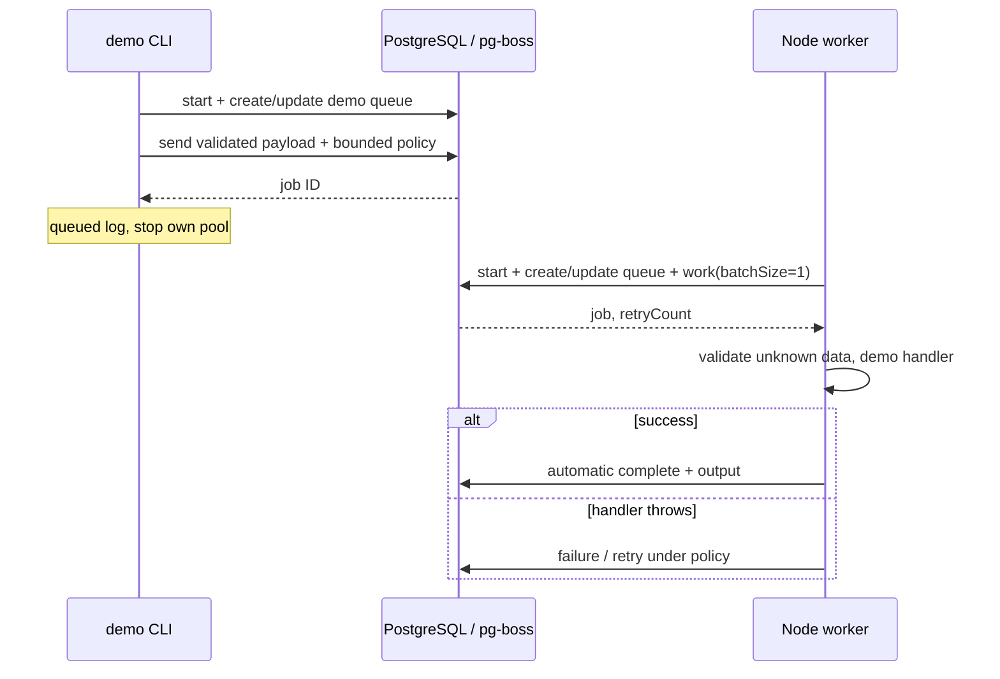

# Worker, jobs и транзакционные ограничения

Сейчас существует один production handler — технический `demo.ping`.
Business jobs, Telegram webhook, AI, notifications и FSRS отсутствуют.
Worker и CLI — отдельные Node процессы, Web их не запускает.

## Регистрация и жизненный цикл



`src/index.ts` вызывает `runWorkerProcess`; env валидируется до создания
runtime. `createQueueClient` задаёт отдельный PgBoss pool max 5, connection
timeout 5 секунд, application_name lifeos-worker/lifeos-producer,
schedule=false, supervision только для worker. `start()` управляет queue
schema, `ensureDemoQueue` вызывает createQueue и updateQueue, затем `work`
регистрирует handler с batchSize 1 и poll 1 секунда.

CLI `src/producer.ts` допускает только обычный режим, --fail-once и
--always-fail. Он создаёт один UUID на входе и использует его для обоих trace
IDs, валидирует DTO, вызывает send с явной политикой и закрывает свой pool
в finally. `queued` означает только постановку; успешное выполнение
подтверждается state/output в PostgreSQL.

## Payload, результат и логи

Shared schema `demoPingPayloadSchema` находится в `packages/contracts`:
`{ correlationId: UUID, requestId?: UUID, mode: ok|fail-once|always-fail }`.
Лишние поля и неверные IDs/mode отклоняются. Старые jobs без requestId
совместимы; новые producers его передают. HTTP context переносится через
`createDemoPayload(mode, context)` без повторной генерации. HTTP enqueue
endpoint пока не существует.

Handler валидирует неизвестные data, для ok возвращает
`{ correlation_id, request_id?, status: pong }`. fail-once бросает ошибку
при retryCount 0, always-fail — на каждой попытке. PgBoss сохраняет result
после auto-completion. `processed` log предшествует этому acknowledgment и
сам по себе не является доказательством durable completion.

Structured logs содержат только event/status, job_id, request_id,
correlation_id, attempt и фиксированный code; startup env error добавляет
имена invalid_settings. Raw queue errors/warnings, SQL, credentials и payload
не логируются. Trace IDs — метаданные, не пользовательский ownership.

## Retry, retention и shutdown

| Параметр | Значение |
|---|---|
| retryLimit | 2 retries, максимум 3 попытки |
| retryDelay / backoff / retryDelayMax | 1 секунда / включён с jitter / 10 секунд |
| expireInSeconds | 30 секунд на активную попытку |
| retentionSeconds / deleteAfterSeconds | 86400 / 86400 |
| pollingIntervalSeconds | 1 |

Queue defaults согласуются при старте; producer фиксирует policy для новой
job. Изменение defaults не переписывает политику уже поставленной job.
Expiration не делает произвольный JS handler жёстко отменяемым; обработчик
обязан учитывать возможность повторного исполнения.

SIGINT/SIGTERM запускают одну idempotent stop-процедуру; на Windows также
поддерживается SIGBREAK (Ctrl+Break). `stop({ graceful: true, close: true,
timeout: 10000 })` прекращает fetch и ждёт active handlers, затем pg-boss
settles/aborts оставшиеся jobs и закрывает принадлежащий ему pool. Timeout
ожидания handler не является жёстким пределом всей DB cleanup. Повторный
сигнал не создаёт вторую остановку. Startup/shutdown failure выставляет exit 1.

## Atomic enqueue: реализованное доказательство

`packages/db/tests/fixtures/atomic-operations.ts` открывает Drizzle transaction,
вставляет synthetic operation и выполняет `send(..., { db: fromDrizzle(tx, sql) })`.
Проверен официальный adapter pg-boss 12.38.1 на Drizzle 0.45.4 / pg 8.23.1.
Обе записи commit/rollback вместе. Два независимых pool calls такой гарантии
не дают. Null send result считается ошибкой, новая operation откатывается.

UNIQUE idempotency_key в fixture и READ COMMITTED согласуют producer duplicates;
повтор возвращает исходные operation/job IDs. Конкурентный тест использует
два разных backend PID и barrier до INSERT. Другой queue/mode с тем же ключом
отклоняется; trace metadata не меняет семантику fixture action.

Test-only consumer держит row lock, изменяет SQL effect и processed marker
одной транзакцией. Повтор после commit эффекта до ack пропускает уже сделанное;
rollback эффекта позволяет retry. Это at least once processing с идемпотентным
SQL effect, а не exactly once для произвольного handler или внешнего сервиса.
Production demo handler не получил эту fixture таблицу/marker и не является
готовым бизнес-consumer. Внешние эффекты требуют отдельного решения.

Подробный код/границы: [ADR queue choice](../adr/002-postgres-queue.md),
[ADR atomicity](../adr/002-queue-atomicity.md). API context:
[contracts](../api/contracts.md).

## Запуск и проверки

```sh
pnpm db:up
pnpm worker:build
pnpm worker:start
```

В другом терминале: `pnpm worker:ping`, `pnpm worker:ping --fail-once` или
`pnpm worker:ping --always-fail`. Для dev — `pnpm worker:dev`.
Root .env нужен серверным процессам; build credentials не требует.

`pnpm test:worker` выполняет пять реальных PostgreSQL tests: отдельный CLI/
worker, SQL completion/output, retry/terminal failure, drain/shutdown и
неверная/недоступная DB. На Windows test fixture доставляет SIGINT/SIGTERM
через IPC, поскольку OS kill(SIGTERM) принудителен; production IPC нет.
На Linux используются настоящие POSIX signals.
`pnpm test:db` включает commit/rollback/sequential/concurrent dedupe и replay
тестового SQL consumer. Все integration suites используют dedicated test DB
и freshly owned schemas; cleanup не удаляет application data/volumes.

Исходники проверок: [worker lifecycle suite](../../apps/worker/tests/integration/worker.test.ts),
[atomicity suite](../../packages/db/tests/integration/atomicity.test.ts),
[transaction/consumer fixture](../../packages/db/tests/fixtures/atomic-operations.ts).

Полная цепочка — `pnpm verify`. Evidence:
[Stage 1 acceptance](../tasks/STAGE-01-ACCEPTANCE.md).
